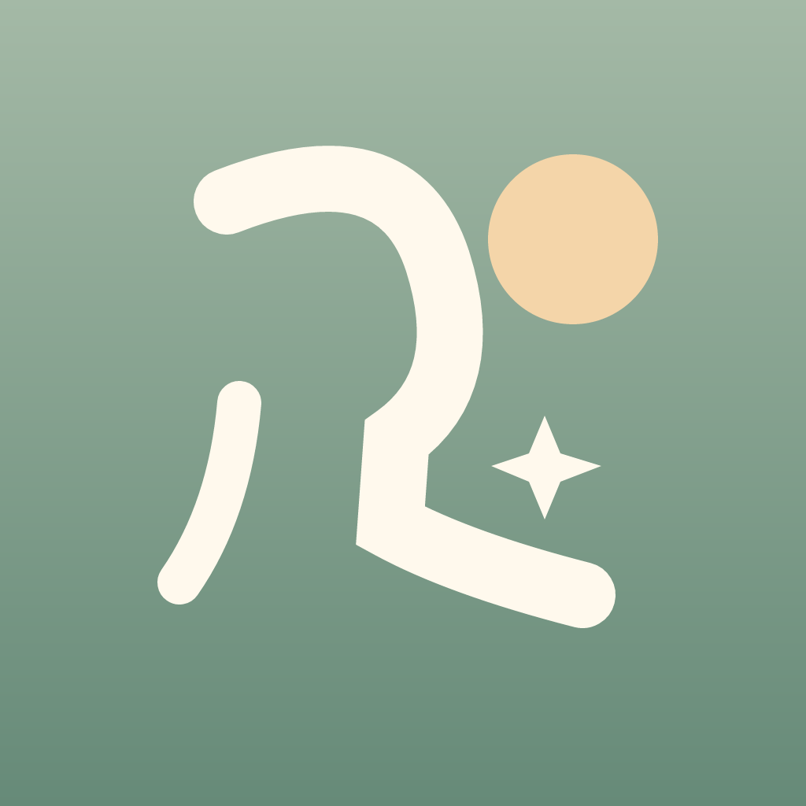

# 颈椎卫士 · NeckGuardian



通过头部姿态平衡高塔、操控纸飞机，并记录舒适活动角度的 PICO Spatial 应用。提供六题颈部感受自评、两项挑战训练及后仰/侧伸测试，支持中英文界面与专业男声引导。

**仅作健康参考，不构成医疗诊断或治疗建议。出现不适请停止练习，必要时就医。**

[下载 1.7 APK 与交互预览](https://github.com/DDDCC5/NeckGuardian/releases/tag/v1.7) · [1.7 版本说明](docs/releases/1.7.md) · [原投稿资料](submission/v1.6/00-填写指南.md) · [验证范围](docs/VERIFICATION.md)

## 功能

- 颈部自评：六道日常感受问题，以不同图形与颜色区分三档参考提示。
- 稳姿高塔：设置低头角度、挑战时长和宽容时间，回正恢复，持续超限后倾倒。
- 舒颈飞行：保持侧倾来转向，收集星星；统计收集、错过、完成率和时长。
- 常规测试：前方角度条和指针显示后仰/侧伸，记录舒适范围内的最大角度。
- 最近 30 条本地历史、简体中文/英文随系统切换、专业男声讲解与操作提示。

菜单与自评使用原生窗口。需要真实角度的训练进入透视 Full Space；期间其他应用退到后台，结束后返回窗口。Shared Space 不提供真实头姿，应用不宣称后台跨应用姿态监测。

## 构建与运行

当前版本：`1.7`，`versionCode 8`，包名 `com.example.neckguardian`。目标为支持 PICO Spatial 的 PICO OS 6 / ARM64 设备；普通 Android 手机不具备相应空间运行服务。

依赖：JDK 21、Android SDK 35、Build Tools 35.0.0。工程使用 Gradle 8.13、AGP 8.13.2、Kotlin 2.1.20、PICO Spatial SDK BOM 6.2.8。配置 `ANDROID_HOME` 或本机 `local.properties` 后：

```sh
./gradlew assembleDebug testDebugUnitTest
```

APK：`app/build/outputs/apk/debug/app-debug.apk`。GitHub Actions 会在 main 推送及 PR 时构建并运行测试。云端生成的 debug 签名可能与下载页 APK 不同；如不能覆盖安装，请保留原安装与数据，不要直接卸载。

使用已配置的 PICO CLI 安装：

```sh
pico-cli app install app/build/outputs/apk/debug/app-debug.apk --device <serial> --replace
pico-cli app launch com.example.neckguardian --device <serial>
```

源码结构与判定定义见 [架构说明](docs/ARCHITECTURE.md)。素材生成脚本及来源元数据见 `production/`；运行资产位于 `app/src/main/assets/`。仅构建应用无需重新生成素材。

## 投稿与来源

当前投稿包包含图标、海报、模拟器运行截图、可复制介绍、版本说明、AI 辅助开发说明及填写字段。图标与海报为宣传物料，截图另行标注，不把宣传设计当作实机验证。

[第三方组件与素材来源](THIRD_PARTY_NOTICES.md)。源码公开用于查看与评审，项目未另行声明整体开源许可证。
